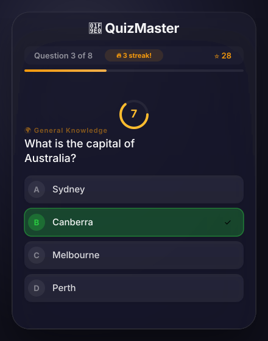
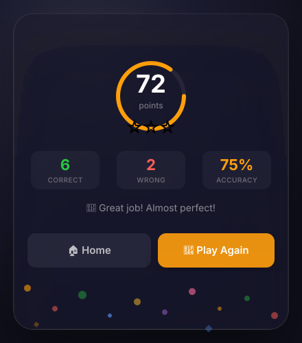

# 🧠 QuizMaster

A modern, interactive quiz app with a sleek glassmorphism dark theme, multiple categories, and rich feedback animations.

## Features

- **6 Categories** — General Knowledge, Science, History, Technology, Geography, Entertainment (8 questions each)
- **Animated Timer** — 15-second countdown ring per question with color transitions
- **Scoring System** — Points + time bonus + streak multiplier
- **Streak Tracker** — 🔥 shows active streak for consecutive correct answers
- **Rich Feedback** — Correct/wrong animations with audio beeps (Web Audio API)
- **Results Screen** — Score ring animation, star rating (1-3⭐), accuracy stats
- **Confetti** — 🎉 Celebration effect for high scores (2+ stars)
- **Keyboard Support** — Press `1-4` to answer, `Enter` to retry, `Escape` to go home
- **Sound Effects** — Correct/wrong chimes via Web Audio API
- **Responsive** — Works on mobile and desktop
- **Dark Glassmorphism** — macOS-style blurred backdrop design

## Usage

Just open `quiz_app.html` in any modern browser — no server needed.

### Keyboard Shortcuts

| Key | Action |
|---|---|
| `1` `2` `3` `4` | Select answer |
| `Enter` | Retry quiz (results screen) |
| `Escape` | Go home (results screen) |

## License

MIT
